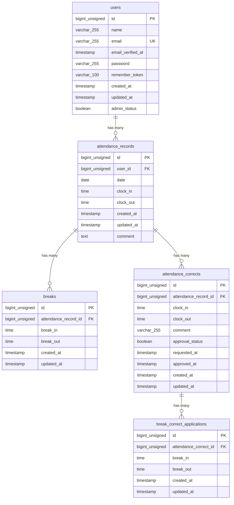

# COACHTECH 勤怠管理アプリ

一般ユーザーが出勤・退勤・休憩の打刻、勤怠一覧の確認、勤怠修正申請を行えるアプリ。

管理者はスタッフの勤怠情報の確認、勤怠修正申請の承認、スタッフ別の月次勤怠データのCSV出力を行うことができる。

## 作成者

宮本 歩優

## 使用技術

- Laravel Framework 10.50.3
- PHP 8.2
- MySQL 8.4
- Composer 2.10.1
- Laravel Sail
- Docker Desktop
- Laravel Fortify
- Vite

## ER図



## 開発環境URL

一般ユーザーログイン画面

http://localhost/login

管理者ログイン画面

http://localhost/admin/login

phpMyAdmin

http://localhost:8081

Mailpit（メール確認）

http://localhost:8025

※URLは `compose.yaml` のデフォルトポート設定に基づいています。

## 動作環境

- Docker Desktopがインストールされたパソコン
- Git
- PHP 8.5系
- Composer 2系

## 環境構築手順

### 1. リポジトリをクローン

```bash
git clone https://github.com/Ayuu-miyamoto/attendance-app.git
```

### 2. プロジェクトディレクトリに移動

```bash
cd attendance-app
```

### 3. .envファイルの準備

```bash
cp .env.example .env
```

`.env` のデータベース接続設定を以下のように変更する。

```env
DB_CONNECTION=mysql
DB_HOST=mysql
DB_PORT=3306
DB_DATABASE=laravel
DB_USERNAME=sail
DB_PASSWORD=password
```

メール送信設定は以下を使用する。

```env
MAIL_MAILER=smtp
MAIL_HOST=mailpit
MAIL_PORT=1025
MAIL_USERNAME=null
MAIL_PASSWORD=null
MAIL_ENCRYPTION=null
```

### 4. Composer依存パッケージのインストール

```bash
composer install
```

※ホスト側にPHP 8.5系とComposerがインストールされている環境を想定しています。

### 5. Laravel Sailの起動

```bash
./vendor/bin/sail up -d
```

### 6. アプリケーションキーの生成

```bash
./vendor/bin/sail artisan key:generate
```

### 7. データベースのマイグレーションと初期データ投入

```bash
./vendor/bin/sail artisan migrate --seed
```

### 8. フロントエンドの準備

```bash
./vendor/bin/sail npm install
```

開発サーバーを起動する。

```bash
./vendor/bin/sail npm run dev
```

※開発サーバーを起動したターミナルはそのままにしておく。

### 9. アプリケーションへのアクセス

一般ユーザーログイン画面

http://localhost/login

管理者ログイン画面

http://localhost/admin/login

## テストアカウント

| 権限 | ユーザー名 | メールアドレス | パスワード |
|---|---|---|---|
| 一般ユーザー | user1 | user1@example.com | password |
| 一般ユーザー | user2 | user2@example.com | password |
| 管理者 | user3 | user3@example.com | password |

※テストアカウントは `DatabaseSeeder.php` により作成されます。すべてメール認証済みの状態で登録されます。

## 初期データ

`DatabaseSeeder.php` により、以下の勤怠データが登録されます。

- user1：2026年6月〜10月の各月15日分
- user1：2026年11月の平日17日分
- user2：2026年11月の平日17日分
- user3：2026年11月の平日17日分

user1の2026年11月の勤怠データには、以下の勤務パターンが含まれています。

| 勤務パターン | 日数 |
|---|---:|
| 通常勤務（9:00〜18:00） | 10日 |
| 残業（9:00〜20:00） | 3日 |
| 遅刻（9:30〜18:00） | 2日 |
| 早退（9:00〜17:00） | 1日 |
| 長時間労働（8:00〜21:00） | 1日 |

すべての初期勤怠データには、12:00〜13:00の休憩が登録されています。

## テスト実行

LaravelのFeatureテストを実行する。

```bash
./vendor/bin/sail artisan test
```

特定のテストのみ実行する場合：

```bash
./vendor/bin/sail artisan test --filter=AttendanceTest
```

## 機能一覧

### 一般ユーザー

- 会員登録
- ログイン・ログアウト
- メール認証
- 出勤・退勤打刻
- 休憩開始・休憩終了
- 勤怠ステータス表示
- 月次勤怠一覧表示
- 前月・翌月の勤怠表示
- 勤怠詳細表示
- 勤怠修正申請
- 修正申請一覧（承認待ち・承認済み）

### 管理者

- ログイン・ログアウト
- 日次勤怠一覧表示
- 前日・翌日の勤怠表示
- スタッフ勤怠詳細表示
- スタッフ一覧表示
- スタッフ別月次勤怠一覧表示
- 修正申請一覧表示
- 勤怠修正申請の承認
- スタッフ別勤怠データのCSV出力

## 補足事項

- 認証にはLaravel Fortifyを使用しています。
- 一般ユーザーと管理者は `admin_status` により権限を判定しています。
- メール認証にはMailpitを使用しています。
- 勤怠修正申請は管理者による承認機能を備えています。
- スタッフ別勤怠データはCSV形式で出力できます。
