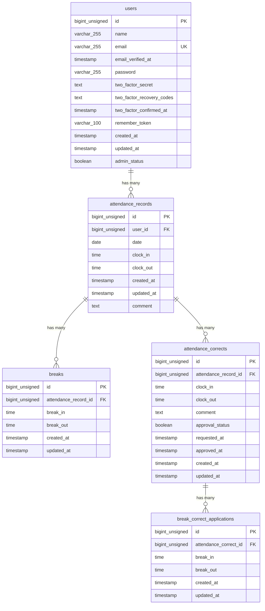

# COACHTECH 勤怠管理アプリ

Laravel 10を使用して作成した勤怠管理アプリです。

一般ユーザーは出勤・退勤・休憩の打刻、勤怠一覧の確認、勤怠修正申請を行うことができます。

管理者はスタッフの勤怠情報の確認・修正、勤怠修正申請の承認、スタッフ別の月次勤怠一覧の確認、CSV出力を行うことができます。

また、新規会員登録時のメール認証、一般ユーザーが自分の勤怠統計レポートを確認することができるマイ勤怠レポート、勤怠情報を操作するAPIも実装しています。

## 作成者

宮本 歩優

## 使用技術

- PHP 8.2
- Laravel 10.50
- MySQL 8.4
- Docker 
- Docker Compose 
- Laravel Sail 
- Laravel Fortify（認証・メール認証）
- Vite 5.4
- Mailpit（メール認証の動作確認）
- phpMyAdmin（データベース管理）

## ER図



## 開発環境URL

- 会員登録：http://localhost/register
- 一般ユーザーログイン：http://localhost/login
- 管理者ログイン：http://localhost/admin/login
- phpMyAdmin：http://localhost:8080
- Mailpit：http://localhost:8025

## テスト用ログイン情報

環境構築時に `./vendor/bin/sail artisan migrate:fresh --seed` を実行すると、以下のユーザーが作成されます。

| ユーザー | 権限 | メールアドレス | パスワード |
|---|---|---|---|
| ユーザー1 | 一般ユーザー | user1@example.com | password |
| ユーザー2 | 一般ユーザー | user2@example.com | password |
| ユーザー3 | 管理者 | user3@example.com | password |

すべてのユーザーはメール認証済みの状態で作成されます。

- 一般ユーザーログイン：http://localhost/login
- 管理者ログイン：http://localhost/admin/login

## 動作環境

- Docker
- Docker Compose
- Git
- ターミナル環境（macOS / Linuxなど）

## 環境構築手順

### 1. リポジトリをクローン

```bash
git clone git@github.com:Ayuu-miyamoto/attendance-app.git
cd attendance-app
```

### 2. Composer依存パッケージのインストール

```bash
docker run --rm \
    -u "$(id -u):$(id -g)" \
    -v "$(pwd):/var/www/html" \
    -w /var/www/html \
    laravelsail/php82-composer:latest \
    composer install --ignore-platform-reqs
```

### 3. .envファイルの準備

`.env` を作成

```bash
cp .env.example .env
```

`.env` ファイルのデータベース接続情報を確認・設定します。

```ini
DB_CONNECTION=mysql
DB_HOST=mysql
DB_PORT=3306
DB_DATABASE=laravel
DB_USERNAME=sail
DB_PASSWORD=password
```

メール認証の動作確認にMailpitを利用する場合は、メール設定も確認します。

```ini
MAIL_MAILER=smtp
MAIL_HOST=mailpit
MAIL_PORT=1025
MAIL_USERNAME=null
MAIL_PASSWORD=null
MAIL_ENCRYPTION=null
MAIL_FROM_ADDRESS="hello@example.com"
MAIL_FROM_NAME="${APP_NAME}"
```

### 4. Laravel Sailの起動

Dockerコンテナを起動します。

```bash
./vendor/bin/sail up -d
```

### 5. アプリケーションキーの生成

```bash
./vendor/bin/sail artisan key:generate
```

### 6. データベースのマイグレーションと初期データ投入

以下のコマンドでテーブルを作成し、ダミーデータを投入します。

```bash
./vendor/bin/sail artisan migrate:fresh --seed
```

データベース接続エラーが発生した場合は、まず `.env` の接続情報とMySQLコンテナの起動状態を確認してください。

```bash
./vendor/bin/sail ps
```

### 7. フロントエンドのセットアップ

npmの依存パッケージをインストールします。

```bash
./vendor/bin/sail npm install
```

Viteの開発サーバーを起動します。

```bash
./vendor/bin/sail npm run dev
```

`npm run dev` は開発中、起動したままにしてください。

### 8. アプリケーションへのアクセス

ブラウザで以下のURLにアクセスします。

- 会員登録：http://localhost/register
- 一般ユーザーログイン：http://localhost/login
- 管理者ログイン：http://localhost/admin/login

## テスト実行

すべてのテストを実行します。

```bash
./vendor/bin/sail artisan test
```

カバレッジ付きで実行する場合：

```bash
./vendor/bin/sail artisan test --coverage
```

## 機能一覧

### 一般ユーザー

- 会員登録
- ログイン・ログアウト
- メール認証
- 出勤・退勤の打刻
- 休憩開始・休憩終了の打刻
- 勤怠ステータスの表示
- 月次勤怠一覧の表示
- 前月・翌月の切り替え
- 勤怠詳細の表示
- 勤怠修正申請
- 修正申請一覧（承認待ち・承認済み）
- マイ勤怠レポート

### 管理者

- 管理者ログイン・ログアウト
- 日次勤怠一覧の表示
- 前日・翌日の切り替え
- 勤怠詳細の表示
- 勤怠情報の登録・修正
- スタッフ一覧の表示
- スタッフ別月次勤怠一覧の表示
- 前月・翌月の切り替え
- CSVエクスポート
- 勤怠修正申請一覧
- 勤怠修正申請の承認

### API

- 勤怠レコード一覧取得
- 勤怠レコード詳細取得
- 勤怠レコード新規作成
- 勤怠レコード更新
- 勤怠レコード削除
- ユーザーIDによる絞り込み

## 画面URL一覧

### 一般ユーザー

| 画面 | URL |
|---|---|
| 会員登録 | /register |
| ログイン | /login |
| 勤怠登録 | /attendance |
| 勤怠一覧 | /attendance/list |
| 勤怠詳細 | /attendance/{id} |
| 勤怠修正申請一覧 | /stamp_correction_request/list |
| マイ勤怠レポート | /attendance/report |

### 管理者

| 画面 | URL |
|---|---|
| ログイン | /admin/login |
| 日次勤怠一覧 | /admin/attendance/list |
| 勤怠詳細 | /admin/attendance/{id} |
| スタッフ一覧 | /admin/staff/list |
| スタッフ別月次勤怠一覧 | /admin/attendance/staff/{id} |
| 勤怠修正申請一覧 | /stamp_correction_request/list |
| 勤怠修正申請詳細・承認 | /stamp_correction_request/approve/{attendance_correct_request_id} |

## APIエンドポイント一覧

勤怠情報を操作するAPIを実装しています。

APIは `/api/v1` プレフィックス配下に定義されています。

| HTTPメソッド | URI | 概要 |
|---|---|---|
| GET | /api/v1/attendance-records | 勤怠一覧取得 |
| GET | /api/v1/attendance-records/{attendanceRecord} | 勤怠詳細取得 |
| POST | /api/v1/attendance-records | 勤怠新規作成 |
| PUT | /api/v1/attendance-records/{attendanceRecord} | 勤怠更新 |
| PATCH | /api/v1/attendance-records/{attendanceRecord} | 勤怠部分更新 |
| DELETE | /api/v1/attendance-records/{attendanceRecord} | 勤怠削除 |
